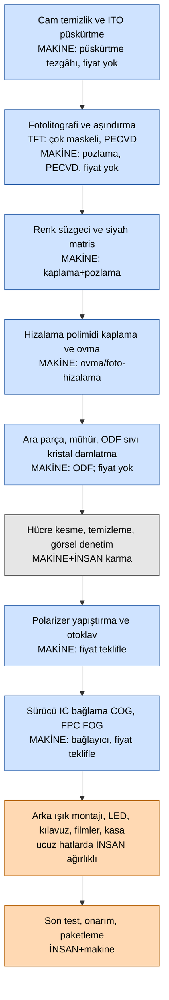
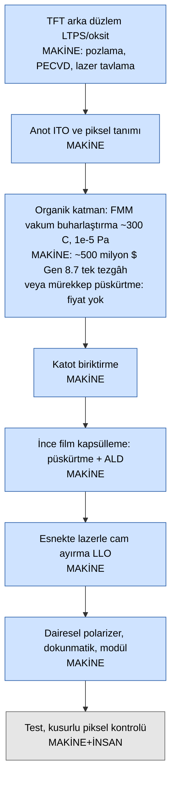
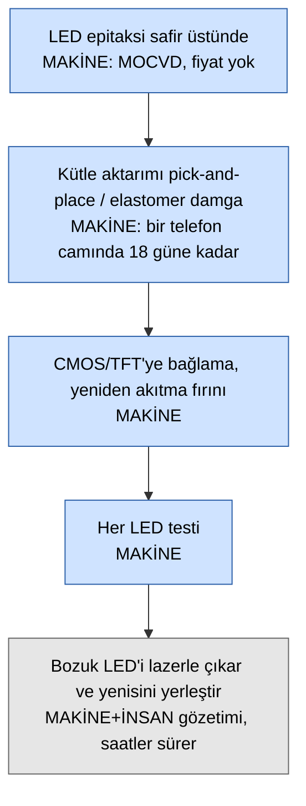
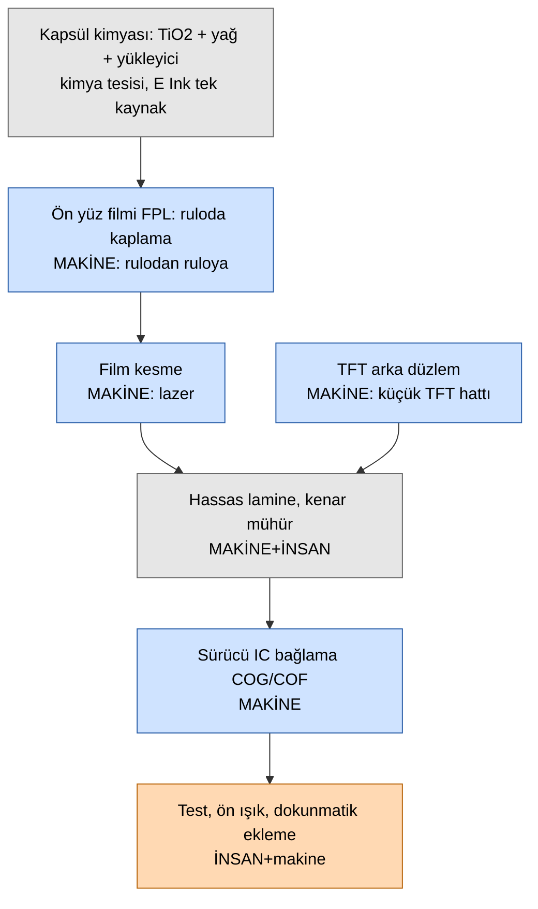
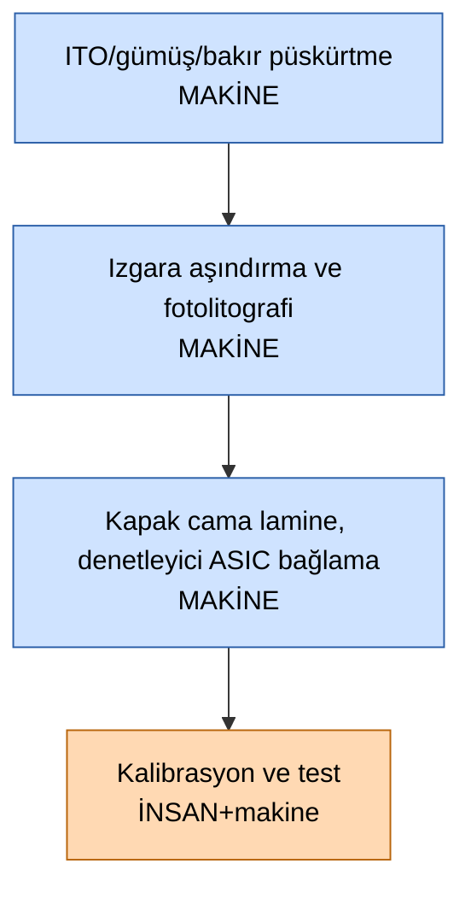

# ÜRETİM SÜRECİ: MAKİNE VE İNSAN AYRIMI, MAKİNE MASRAFLARI

**Tarih:** 2026-11-23
**Renk:** mavi = makine · turuncu = insan (veya ağırlıkla insan) · gri = karma
**Dürüstlük notu:** Makine/insan ayrımı Wikipedia'da açıkça yazılı değildir (CRT'de renk hizalama mıknatıslarının fabrikada elle ayarlanması ve eski CRT'lerin elle yeniden inşası hariç). Ayrım benim süreç bilgimden çıkarımdır, kaynaklı hüküm sayılmasın. Makine fiyatı bulabildiğim kadarıdır; bulunamayan yerde "yok" yazıldı, rakam uydurulmadı.

## Bulunan makine masrafları (hepsi)

| Makine | Rakam | Kaynak durumu |
| :-- | :-- | :-- |
| OLED buharlaştırma (FMM VTE) Gen 8.7 | ~500 milyon $ (tek tezgâh); Samsung 307 milyon $ teklif etti, Ulvac 540–615 milyon $ istedi | trade basını, çelişkili |
| OLED tandem hat, 15 bin alt-tabaka/ay | ~1 milyar $ yalnız biriktirme | Counterpoint/DSCC özeti |
| OLED aracı başı "5–30 milyon $" | zayıf kaynak, tür belirsiz; güvenme | |
| OLED mürekkep püskürtme (Kateeva) | tezgâh fiyatı yok; yalnız "LCD maliyetinden %30 düşük" iddiası (satıcı) | |
| Püskürtme (sputter), PECVD, pozlama | tek tezgâh fiyatı bulunamadı | |
| COG/FOG bağlayıcı, polarizer yapıştırıcı, otoklav | fiyat yok, "teklif alın" (Panasonic sayfaları) | |
| Fab toplamı | Samsung 8.6G dönüşümü 3,1 milyar $; BOE 8.7G esnek 8,8 milyar $+; modül hattı 2–8 milyon $; STN hattı ~22 milyon $ (önceki defter) | önceki defter + arama |

Sonuç: hücre (TFT, ITO, buharlaştırma) tezgâhlarının tek tek fiyatı açıkta yok; yalnız fab toplamı ve OLED buharlaştırma var. Modül tezgâhlarının fiyatı satıcı teklifine kalıyor.

## 1. LCD (TN/STN/IPS/VA)

Fab: Gen 6 ~3,54 milyar $, Gen 8.5 ~5,35 milyar $ (önceki defter, kaynak yoklanmadı). Modül hattı 2–8 milyon $. STN hattı ~22 milyon $.

## 2. OLED / AMOLED

Toplam: 3,1 milyar $ (dönüşüm) ile 8,8 milyar $+ (yeni 8.7G esnek).

## 3. microLED

Makine fiyatı yok; Apple milyarlarca $ harcayıp saat için vazgeçti (Wikipedia).

## 4. E-kâğıt (elektroforetik)

Makine fiyatı yok; kapsül kimyası ve filmi E Ink'in sırrı.

## 5. Dokunmatik katman

Dirençli: iki ITO film, arada boşluk, çok daha basit ve ucuz.

## 6. Eski türler

```mermaid
flowchart TD
  classDef m fill:#cfe3ff,stroke:#2b5fa8,color:#000
  classDef i fill:#ffd9b3,stroke:#b8650b,color:#000
  classDef k fill:#e6e6e6,stroke:#666,color:#000
  subgraph CRT
    c1["Cam pres ve eritme<br/>MAKİNE"]:::m --> c2["Siyah matris+fosfor fotolitografi, alüminyum buharlaştırma<br/>MAKİNE"]:::m --> c3["Cam tutkal frit fırını 435-475 C<br/>MAKİNE"]:::m --> c4["Elektron tabancası takma ve mühür, vakum fırını 375-475 C<br/>MAKİNE"]:::m --> c5["Yakınsama ve saflık mıknatısları fabrikada ayarlanır<br/>İNSAN (Wikipedia)"]:::i
  end
  subgraph PLAZMA
    p1["Cam, gümüş macun elektrot, ekran baskı<br/>MAKİNE"]:::m --> p2["Kaburga: kumlama veya fotolitografi, sinterleme<br/>MAKİNE"]:::m --> p3["Fosfor püskürtme invar maskeyle<br/>MAKİNE"]:::m --> p4["MgO elektron ışını buharlaştırma, mühür, gaz doldurma<br/>MAKİNE"]:::m
  end
  subgraph VFD
    v1["Tungsten filaman+karbonat, ızgara fotokimyasal işleme<br/>MAKİNE"]:::m --> v2["Anot cam, grafit, fosfor<br/>MAKİNE"]:::m --> v3["Montaj, vakum, karbonatı oksite çevirme<br/>İNSAN+makine"]:::k
  end
  subgraph DLP_LCoS
    d1["DMD/CMOS çip yarı iletken fabında<br/>MAKİNE"]:::m --> d2["Modül, optik, renk çarkı/LED, hizalama<br/>İNSAN+makine"]:::k
  end
```

Makine fiyatı bulunamadı. Plazma/CRT/VFD üretimi sona erdi (plazma 2014–16, CRT 2015).

## Boşluklar

- Tek tek tezgâh fiyatı: yalnız OLED buharlaştırma var; püskürtme, PECVD, pozlama, ODF, COG, polarizer yapıştırma, lamine için yok. Satıcıdan teklif şart.
- İnsan işçilik masrafı hiç bulunmadı.
- Makine/insan ayrımı çıkarımdır.
